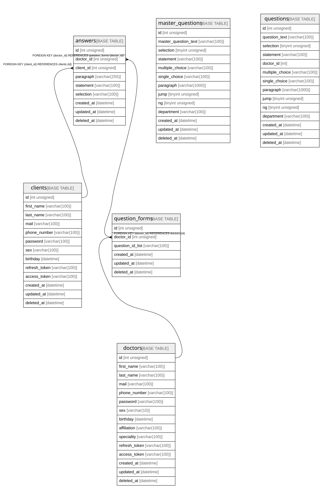

# MedicalQuestionnaireService

## Tables

| Name | Columns | Comment | Type |
| ---- | ------- | ------- | ---- |
| [answers](answers.md) | 9 |  | BASE TABLE |
| [clients](clients.md) | 13 |  | BASE TABLE |
| [doctors](doctors.md) | 15 |  | BASE TABLE |
| [master_questions](master_questions.md) | 13 |  | BASE TABLE |
| [question_forms](question_forms.md) | 6 |  | BASE TABLE |
| [questions](questions.md) | 14 |  | BASE TABLE |

## Relations

---

> Generated by [tbls](https://github.com/k1LoW/tbls)
