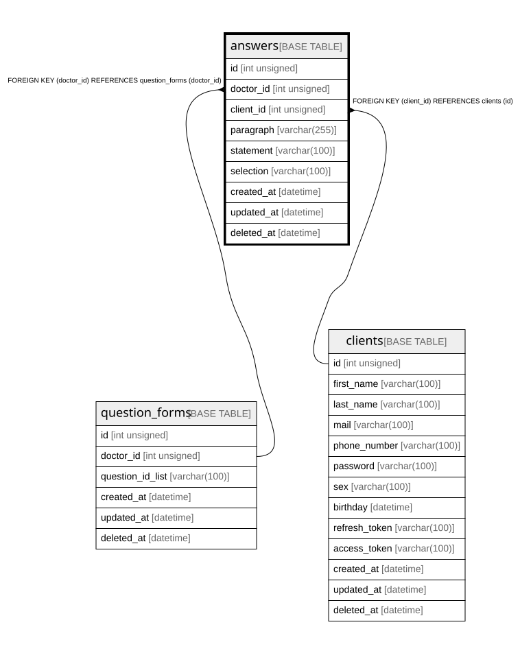

# answers

## Description

<details>
<summary><strong>Table Definition</strong></summary>

```sql
CREATE TABLE `answers` (
  `id` int unsigned NOT NULL AUTO_INCREMENT,
  `doctor_id` int unsigned NOT NULL,
  `client_id` int unsigned NOT NULL,
  `paragraph` varchar(255) DEFAULT NULL,
  `statement` varchar(100) DEFAULT NULL,
  `selection` varchar(100) DEFAULT NULL,
  `created_at` datetime NOT NULL,
  `updated_at` datetime NOT NULL,
  `deleted_at` datetime DEFAULT NULL,
  PRIMARY KEY (`id`),
  KEY `doctor_id` (`doctor_id`),
  KEY `client_id` (`client_id`),
  CONSTRAINT `answers_ibfk_1` FOREIGN KEY (`doctor_id`) REFERENCES `question_forms` (`doctor_id`),
  CONSTRAINT `answers_ibfk_2` FOREIGN KEY (`client_id`) REFERENCES `clients` (`id`)
) ENGINE=InnoDB AUTO_INCREMENT=[Redacted by tbls] DEFAULT CHARSET=utf8mb4 COLLATE=utf8mb4_0900_ai_ci
```

</details>

## Columns

| Name | Type | Default | Nullable | Extra Definition | Children | Parents | Comment |
| ---- | ---- | ------- | -------- | --------------- | -------- | ------- | ------- |
| id | int unsigned |  | false | auto_increment |  |  |  |
| doctor_id | int unsigned |  | false |  |  | [question_forms](question_forms.md) |  |
| client_id | int unsigned |  | false |  |  | [clients](clients.md) |  |
| paragraph | varchar(255) |  | true |  |  |  |  |
| statement | varchar(100) |  | true |  |  |  |  |
| selection | varchar(100) |  | true |  |  |  |  |
| created_at | datetime |  | false |  |  |  |  |
| updated_at | datetime |  | false |  |  |  |  |
| deleted_at | datetime |  | true |  |  |  |  |

## Constraints

| Name | Type | Definition |
| ---- | ---- | ---------- |
| answers_ibfk_1 | FOREIGN KEY | FOREIGN KEY (doctor_id) REFERENCES question_forms (doctor_id) |
| answers_ibfk_2 | FOREIGN KEY | FOREIGN KEY (client_id) REFERENCES clients (id) |
| PRIMARY | PRIMARY KEY | PRIMARY KEY (id) |

## Indexes

| Name | Definition |
| ---- | ---------- |
| client_id | KEY client_id (client_id) USING BTREE |
| doctor_id | KEY doctor_id (doctor_id) USING BTREE |
| PRIMARY | PRIMARY KEY (id) USING BTREE |

## Relations



---

> Generated by [tbls](https://github.com/k1LoW/tbls)
