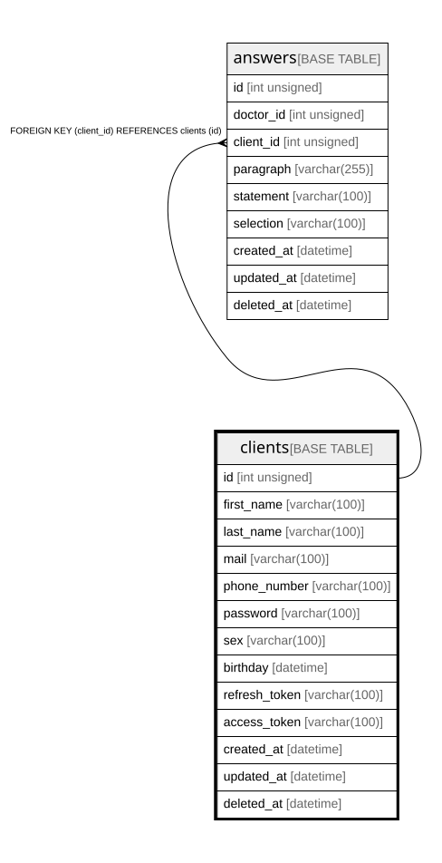

# clients

## Description

<details>
<summary><strong>Table Definition</strong></summary>

```sql
CREATE TABLE `clients` (
  `id` int unsigned NOT NULL AUTO_INCREMENT,
  `first_name` varchar(100) NOT NULL,
  `last_name` varchar(100) NOT NULL,
  `mail` varchar(100) NOT NULL,
  `phone_number` varchar(100) NOT NULL,
  `password` varchar(100) NOT NULL,
  `sex` varchar(100) NOT NULL,
  `birthday` datetime NOT NULL,
  `refresh_token` varchar(100) NOT NULL,
  `access_token` varchar(100) NOT NULL,
  `created_at` datetime NOT NULL,
  `updated_at` datetime NOT NULL,
  `deleted_at` datetime DEFAULT NULL,
  PRIMARY KEY (`id`),
  UNIQUE KEY `mail` (`mail`)
) ENGINE=InnoDB AUTO_INCREMENT=[Redacted by tbls] DEFAULT CHARSET=utf8mb4 COLLATE=utf8mb4_0900_ai_ci
```

</details>

## Columns

| Name | Type | Default | Nullable | Extra Definition | Children | Parents | Comment |
| ---- | ---- | ------- | -------- | --------------- | -------- | ------- | ------- |
| id | int unsigned |  | false | auto_increment | [answers](answers.md) |  |  |
| first_name | varchar(100) |  | false |  |  |  |  |
| last_name | varchar(100) |  | false |  |  |  |  |
| mail | varchar(100) |  | false |  |  |  |  |
| phone_number | varchar(100) |  | false |  |  |  |  |
| password | varchar(100) |  | false |  |  |  |  |
| sex | varchar(100) |  | false |  |  |  |  |
| birthday | datetime |  | false |  |  |  |  |
| refresh_token | varchar(100) |  | false |  |  |  |  |
| access_token | varchar(100) |  | false |  |  |  |  |
| created_at | datetime |  | false |  |  |  |  |
| updated_at | datetime |  | false |  |  |  |  |
| deleted_at | datetime |  | true |  |  |  |  |

## Constraints

| Name | Type | Definition |
| ---- | ---- | ---------- |
| mail | UNIQUE | UNIQUE KEY mail (mail) |
| PRIMARY | PRIMARY KEY | PRIMARY KEY (id) |

## Indexes

| Name | Definition |
| ---- | ---------- |
| PRIMARY | PRIMARY KEY (id) USING BTREE |
| mail | UNIQUE KEY mail (mail) USING BTREE |

## Relations



---

> Generated by [tbls](https://github.com/k1LoW/tbls)
