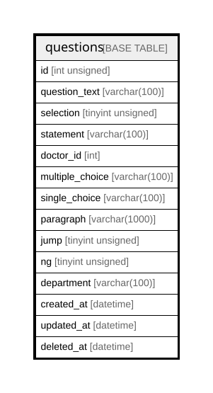

# questions

## Description

<details>
<summary><strong>Table Definition</strong></summary>

```sql
CREATE TABLE `questions` (
  `id` int unsigned NOT NULL AUTO_INCREMENT,
  `question_text` varchar(100) NOT NULL,
  `selection` tinyint unsigned NOT NULL,
  `statement` varchar(100) NOT NULL,
  `doctor_id` int NOT NULL DEFAULT '0',
  `multiple_choice` varchar(100) DEFAULT NULL,
  `single_choice` varchar(100) DEFAULT NULL,
  `paragraph` varchar(1000) DEFAULT NULL,
  `jump` tinyint unsigned DEFAULT NULL,
  `ng` tinyint unsigned DEFAULT NULL,
  `department` varchar(100) NOT NULL,
  `created_at` datetime NOT NULL,
  `updated_at` datetime NOT NULL,
  `deleted_at` datetime DEFAULT NULL,
  PRIMARY KEY (`id`)
) ENGINE=InnoDB AUTO_INCREMENT=[Redacted by tbls] DEFAULT CHARSET=utf8mb4 COLLATE=utf8mb4_0900_ai_ci
```

</details>

## Columns

| Name | Type | Default | Nullable | Extra Definition | Children | Parents | Comment |
| ---- | ---- | ------- | -------- | --------------- | -------- | ------- | ------- |
| id | int unsigned |  | false | auto_increment |  |  |  |
| question_text | varchar(100) |  | false |  |  |  |  |
| selection | tinyint unsigned |  | false |  |  |  |  |
| statement | varchar(100) |  | false |  |  |  |  |
| doctor_id | int | 0 | false |  |  |  |  |
| multiple_choice | varchar(100) |  | true |  |  |  |  |
| single_choice | varchar(100) |  | true |  |  |  |  |
| paragraph | varchar(1000) |  | true |  |  |  |  |
| jump | tinyint unsigned |  | true |  |  |  |  |
| ng | tinyint unsigned |  | true |  |  |  |  |
| department | varchar(100) |  | false |  |  |  |  |
| created_at | datetime |  | false |  |  |  |  |
| updated_at | datetime |  | false |  |  |  |  |
| deleted_at | datetime |  | true |  |  |  |  |

## Constraints

| Name | Type | Definition |
| ---- | ---- | ---------- |
| PRIMARY | PRIMARY KEY | PRIMARY KEY (id) |

## Indexes

| Name | Definition |
| ---- | ---------- |
| PRIMARY | PRIMARY KEY (id) USING BTREE |

## Relations



---

> Generated by [tbls](https://github.com/k1LoW/tbls)
